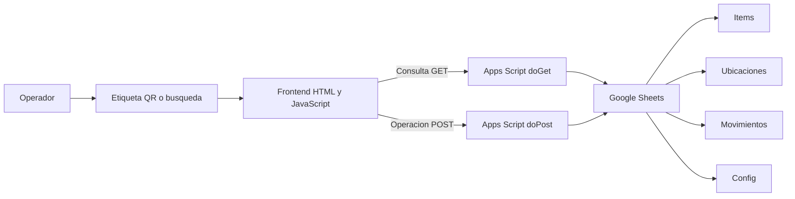
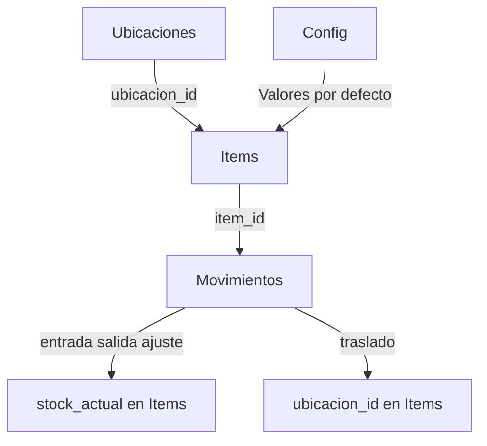
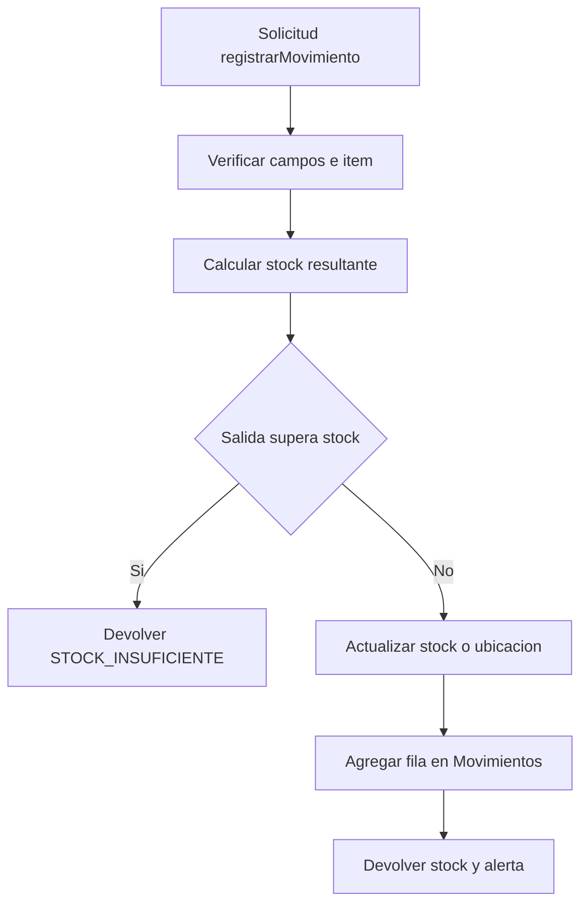

# Mapa del proyecto — Bodega DanTin

[Volver al README](../README.md) · [Revisión](REVISION.md)

## Qué organiza

Un inventario con identificadores QR, ubicaciones, stock y movimientos. Apps Script es el backend y Google Sheets el almacenamiento. «Sin servidor propio» no significa «sin backend».

## Arquitectura y relaciones

El frontend y el dashboard constan en el inventario y en la documentación existente; esta revisión inspeccionó el backend, no probó cámara, QR, red ni gráficos de la interfaz.

## Recorrido de un movimiento observado en el código

El orden de estas escrituras importa: actualizar el ítem y agregar el movimiento son pasos separados, sin transacción visible. Una falla intermedia o dos solicitudes simultáneas requieren manejo explícito, no una garantía documental.

## Mapa de API existente

| Transporte | Acciones observadas |
|---|---|
| GET | `getItems`, `getItem`, `getUbicaciones`, `getMovimientos`, `getStats`, `searchItems` |
| POST | `createItem`, `updateItem`, `registrarMovimiento` |

Para el contrato original, consultar [03-api-contract.md](03-api-contract.md). Para la estructura de hojas, [schema.md](../data-schema/schema.md). Estos documentos se conservaron; no se auditó cada uno de sus campos.

## Cómo leer el estado sin confundirlo con producción

- El README anterior decía que las etapas 1–7 estaban pendientes.
- `PROGRESO.md` las marca completadas, pero también enumera requisitos previos a producción.
- El código revisado conserva `SHEET_ID = 'TU_SHEET_ID_AQUI'`.
- Existen código y documentación. No se comprobó que una instancia esté desplegada, conectada ni validada.

Consultar [07-deploy.md](07-deploy.md) como guía existente; no mover `frontend/` ni cambiar URLs de forma automática.

## Seguridad y validaciones pendientes

- No se observa autenticación ni autorización en los enrutadores leídos. No publicar el endpoint abierto con información real sin diseñar controles efectivos.
- Validar tipos y cantidades positivas; el chequeo de cantidad por valor verdadero/falso no garantiza valores válidos.
- Revisar el ajuste a cero, tipos de movimiento admitidos, ubicación de destino y lista de campos editables.
- Incorporar controles de concurrencia y recuperación ante escritura parcial.
- Probar entrada, salida, stock insuficiente, ajuste, traslado y alerta con una planilla de prueba.
- Definir respaldo de la planilla: guardar el código en GitHub no respalda sus registros.

## Orden propuesto, no migración realizada

Mantener `frontend/`, `apps-script/`, `data-schema/` y `docs/`. Usar README como entrada, MAPA para entender relaciones y PROGRESO como historia; marcar despliegue y aceptación con evidencia independiente. `08-propuesta.md` continúa pendiente y no se presenta como entregable existente.
